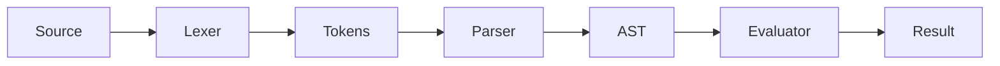

An interpreter that walks the syntax tree is the simplest way to run a language.
This post builds one in Rust, step by step.

It has three parts: a lexer, a parser, and the evaluator. The theory is in
[[notes-on-computable-numbers]].

<!-- more -->

## The pipeline



## Evaluating expressions

```rust
fn eval(expr: &Expr) -> i64 {
    match expr {
        Expr::Num(n) => *n,
        Expr::Add(a, b) => eval(a) + eval(b),
        Expr::Mul(a, b) => eval(a) * eval(b),
    }
}
```

Evaluation takes time proportional to the tree's size, $O(n)$.
