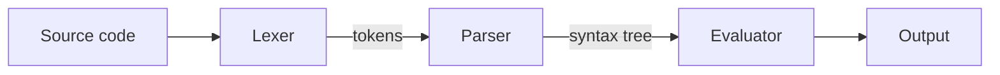

```preamble
\newcommand{\R}{\mathbb{R}}
\newcommand{\norm}[1]{\left\lVert #1 \right\rVert}
\newcommand{\abs}[1]{\left\lvert #1 \right\rvert}
\newcommand{\dd}{\,\mathrm{d}}
```

This post is a tour of what you can put in a post or a project page. Each section says how to write it.
Posts are markdown files in `src/content/blog/` and projects are in `src/content/projects/`.

## Images

Write `` with the file in `public/images/`:


Images are made smaller when the site is built: your browser gets an AVIF or WebP copy in the size that fits
your screen, and images further down only load when you scroll near them. Click an image to see it full screen. With several images in a post, the arrow keys or a swipe move
between them, and Escape closes the viewer.

### Before and after

A `compare` block puts two images on top of each other with a divider you can drag, or move with the
arrow keys once it has focus:

````md
```compare
before: /images/sphere-flat.png | Flat
after: /images/sphere-lit.png | Lit
alt: A sphere, with and without lighting
```
````

```compare
before: /images/sphere-flat.png | Flat
after: /images/sphere-lit.png | Lit
alt: A blue sphere, with and without lighting
caption: The same sphere before and after adding diffuse and specular light.
```

## Videos

A YouTube or Vimeo link on a line of its own becomes a player. Nothing loads from YouTube or Vimeo until you
press play:

https://www.youtube.com/watch?v=aqz-KE-bpKQ

https://vimeo.com/76979871

## PDFs and Goodnotes

A link to a PDF on its own line shows the pages right in the post. For Goodnotes, use Export → PDF and
put the file in `public/files/`:

/files/sample-notes.pdf

## 3D models

A `.glb` or `.gltf` file on its own line becomes a viewer you can rotate and zoom. Put the file in
`public/models/`:

/models/crystal.glb

## Rendered with Rust and wgpu

A Rust program that draws with [wgpu](https://wgpu.rs), built for the web with wasm-bindgen, runs in a
canvas on the page. Put the build in `public/wasm/<name>/` and write the path to its `.js` file on its own
line. It starts when you press Run, and shows a placeholder like this one until the files are there:

/wasm/renderer/renderer.js

## Maths

Inline maths goes between single dollar signs, like $e^{i\pi} + 1 = 0$, and display maths between double
ones:

$$
\int_{-\infty}^{\infty} e^{-x^2} \dd x = \sqrt{\pi}
$$

The `preamble` block at the top of this post defines `\R`, `\norm`, `\abs` and `\dd`, and every formula
in the post can use them. For every $x \in \R^n$ the triangle inequality says
$\norm{x + y} \le \norm{x} + \norm{y}$, and $\abs{\langle x, y \rangle} \le \norm{x}\,\norm{y}$ is
Cauchy–Schwarz. Boxes work too: $\boxed{E = mc^2}$ and $\fbox{text in a box}$.

### Numbered equations, theorems and proofs

Put `\label{name}` in a display formula to number it, and write `\eqref{name}` anywhere to link to it.
The Gaussian integral
$$
\int_{-\infty}^{\infty} e^{-a x^2} \dd x = \sqrt{\frac{\pi}{a}} \label{gauss}
$$
gives \eqref{gauss}, and with $a = 1$ it becomes the formula above.

Theorems, lemmas, corollaries and definitions are blockquotes that start with `[!THEOREM]` and so on.
They are numbered together, and `\ref{name}` links to one:

> [!DEFINITION] Norm \label{def-norm}
> A norm on $\R^n$ is a function $\norm{\cdot}$ with $\norm{x} = 0 \iff x = 0$,
> $\norm{\lambda x} = \abs{\lambda}\norm{x}$ and $\norm{x + y} \le \norm{x} + \norm{y}$.

> [!THEOREM] Cauchy–Schwarz \label{thm-cs}
> For all $x, y \in \R^n$, $\abs{\langle x, y \rangle} \le \norm{x}\,\norm{y}$.

> [!PROOF]
> If $y = 0$ both sides are zero. Otherwise $0 \le \norm{x - t y}^2$ for every real $t$; choosing
> $t = \langle x, y \rangle / \norm{y}^2$ and expanding gives the inequality.

Theorem \ref{thm-cs} uses the Euclidean norm, which is a norm in the sense of Definition \ref{def-norm}.

### Sliders

A `vars` block makes sliders, and their values update live wherever they are used: as `` `=a` `` in
text, as `\var{a}` in formulas, and in `fnplot` function plots.

````md
```vars
a = 1.5 range 0..3 step 0.1 Amplitude
k = 2 range 1..6 step 1 Frequency
```
````

```vars
a = 1.5 range 0..3 step 0.1 Amplitude
k = 2 range 1..6 step 1 Frequency
d = 0.2 range 0..1 step 0.05 Damping
```

The wave below has amplitude `=a` and repeats every `=2*pi/k` units; after one period it has shrunk to
`=a*exp(-d*2*pi/k)`.

$$
y = \var{a}\, e^{-\var{d} x} \sin(\var{k} x)
$$

```fnplot
y: a*exp(-d*x)*sin(k*x), a*exp(-d*x), -a*exp(-d*x)
x: 0..3*pi
y-range: -3..3
title: A damped wave and its envelope
```

## Code

Fenced code gets highlighting, a language label and a copy button:

```rust title="hello.rs"
fn main() {
    println!("Hello from Rust");
}
```

A path to a source file on its own line includes the file (here, only the token type):

/code/interpreter/lexer.rs#L3-L14

There's more on this in [[code-blocks|Showing code on this site]].

### Changes to code

A `diff` block shows a change side by side or in one column, with highlighting. Paste a unified diff, or
name two files and the site works out the difference:

````md
```diff
from: /code/interpreter/history/eval-v1.rs
to: /code/interpreter/history/eval-v2.rs
```
````

```diff title="Errors instead of panics"
from: /code/interpreter/history/eval-v1.rs
to: /code/interpreter/history/eval-v2.rs
```

```diff lang=rust title="A pasted diff"
@@ -3,3 +3,3 @@ fn eval
-        Expr::Var(name) => env.get(name).unwrap().clone(),
+        Expr::Var(name) => env.get(name).cloned().ok_or(Error::Undefined)?,
```

### Diagrams

A `mermaid` block draws a diagram in the colours of the current light or dark mode:



## Files

Text files show their contents, and CSV files become a table. Put them anywhere in `public/` and write
the path on its own line:

/files/interpreter-notes.txt

/files/benchmarks.csv

## Charts from CSV files

A `plot` block draws a chart from a CSV file in `public/`. Pick the type (`line`, `bar` or `scatter`), the
column for the x axis and up to three columns for y. Charts are drawn when the site is built, follow light and
dark mode, and have a "Show the data" table:

```plot
file: /files/fib-timings.csv
type: line
x: n
y: Tree-walking (ms), Bytecode (ms)
title: Time to compute fib(n)
x-label: n
y-label: Milliseconds
```

```plot
file: /files/benchmarks.csv
type: bar
x: Program
y: Tree-walking (ms), Bytecode (ms)
title: Run time per benchmark
y-label: Milliseconds
```

## Notes, footnotes and citations

> [!NOTE]
> Callouts are blockquotes that start with `[!NOTE]`, `[!TIP]`, `[!IMPORTANT]`, `[!WARNING]` or
> `[!CAUTION]`. Add words after the marker to give one its own title.

> [!WARNING] Drafts stay private
> A post with `draft: true` shows up in `npm run dev` but never on the live site.

Footnotes use `[^name]`.[^margin] On a wide screen they sit in the margin next to the text, like
sidenotes in a book; on a phone they collect at the end of the post.[^phone]

[^margin]: This one is in the margin if your screen is wide enough.
[^phone]: Tap the number to jump to it, and the arrow to jump back.

Citations are keys from a BibTeX file in square brackets: `[@nystrom2021]` gives [@nystrom2021], and
several at once with a page work too [@abelson1996, ch. 4; @turing1936]. Keys come from
`src/content/references.bib`, or a post's own `bibliography:` file, and the list of references at the end
is made for you. A key that isn't in any file stops the build.

## Snippets

Text you reuse goes in `src/content/snippets/`, and `{{snippet name}}` on its own line puts it in a post.
Values like `what="closures"` fill in `{{what}}` inside the snippet:

{{snippet try-the-interpreter what="the examples from this post"}}

## Downloads

A link to a file gets a download button with its size when you give it the title `"download"`, like
`[the notes](/files/sample-notes.pdf "download")`. Archives such as `.zip` files always download. Both
are below: [the lexer source](/files/interpreter-lexer.zip) and
[the sample notes](/files/sample-notes.pdf "download").

## Links between posts and projects

Write `[[slug]]` to link to another post or project by its file name, or `[[slug|your own text]]` to
choose the link text. This links to [[interpreter]] and to
[[how-a-tree-walking-interpreter-works|the post about how it works]]. Pages that are linked to list the
posts that link to them under "Referenced by", and a link to something that doesn't exist stops the build.

## Links to other sites

Ordinary links to other websites, like [the Rust book](https://doc.rust-lang.org/book/) or
[WebAssembly.org](https://webassembly.org), open in a new tab and get a small arrow so you can tell.

## Live demos

A project can run a WebAssembly build right on its page. The [[interpreter]] project has a playground
where you type code and see what it prints. It shows a placeholder until the `.wasm` file is added to
`public/wasm/interpreter/`.

## Around every post

Every post and project also gets these, without writing anything:

- **Share buttons** in the side column: copy the link, LinkedIn, X and Bluesky, and your phone's own share
  sheet where there is one. They are plain links, so nothing is loaded from those sites until you click.
- **A preview image** for link previews on social sites, drawn from the title and description when the
  site is built, unless the post has a `cover:` image.
- **History**: a list at the end of every commit that changed the post, each linked to its changes on GitHub.
- **Related posts**, picked by meaning with the search vectors.
- **Authors**: a byline with links to each author's page. Add people to `src/content/authors.yaml` and
  list them with `authors: [ada]`; posts by someone else than the site's owner are marked "Guest post".

Projects can show a status badge with `status: active` (or `maintained`, `experimental`, `paused`,
`finished`, `archived`), like the one on [[interpreter]].

The [CV](/cv/) is made from `src/content/cv.yaml`, with a PDF version printed when the site is built.

## Fast, and checked

Heavy things load only when you get near them: the PDF viewer, the 3D viewer, diagrams and the search code
(which waits until you use the search box). 3D models are shown from a compressed copy, and the Download
button still gives you the original file.

Every time the site changes, it is checked automatically:

- every link, image and embed on every page, including links to other sites and whether videos still exist;
- a Lighthouse score for speed, accessibility, best practices and SEO, and a size budget for each page;
- screenshots of the main pages in light and dark mode on a phone, at 1080p and at 4K, compared with the
  last approved ones.

## Search

Everything here is searchable from the bar at the top, by keyword or by meaning, and formulas in the
results are rendered too. Try searching for "triangle inequality" or "how are closures stored".
