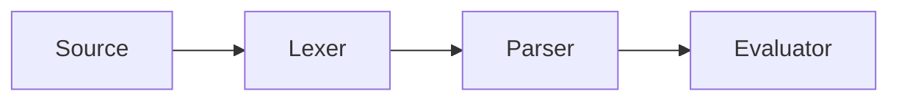

```preamble
\newcommand{\dd}{\mathrm{d}}
```

## Callouts

> [!NOTE]
> Plain notes use the info colour.

> [!WARNING] Mind the gap
> A warning with its own title.

## Footnotes

Tree-walking interpreters are simple[^simple] and bytecode is faster.[^fast]

[^simple]: They evaluate the syntax tree directly.
[^fast]: Usually by a factor of three to ten.

## Diagram



## Diffs

```diff lang=rust title="Pasted diff"
@@ -1,3 +1,3 @@
-fn add(a: i32, b: i32) -> i32 {
+fn add(a: i64, b: i64) -> i64 {
     a + b
 }
```

```diff
from: /code/diff/v1.rs
to: /code/diff/v2.rs
```

## Equations

The energy is
$$
E = mc^2 \label{energy}
$$
and the integral
$$
\int_0^1 x \, \dd x = \tfrac12 \label{half}
$$
Both \eqref{energy} and $\eqref{half}$ are numbered.

> [!THEOREM] Pythagoras \label{pyth}
> For a right triangle, $a^2 + b^2 = c^2$.

> [!PROOF]
> Rearrange four copies of the triangle.

Theorem \ref{pyth} is famous.

## Citations

See [@knuth1984, p. 12] and [@nystrom2021; @turing1936]. Knuth again [@knuth1984].

## Before and after

```compare
before: /images/sphere-flat.png | Flat
after: /images/sphere-lit.png | Lit
alt: A blue sphere
caption: Lighting makes the shape readable.
```

## Images


## Sliders

```vars
a = 2 range 0..5 step 0.5 Amplitude
k = 1 range 1..4 step 1 Frequency
```

The peak is `=a` and twice it is `=2*a`.

$$
y = \var{a} \sin(\var{k} x)
$$

```fnplot
y: a*sin(k*x), a*cos(k*x)
x: -pi..pi
y-range: -5..5
title: A sine wave
```

## Snippets

{{snippet install package="tiny-calc"}}

{{snippet signoff}}
